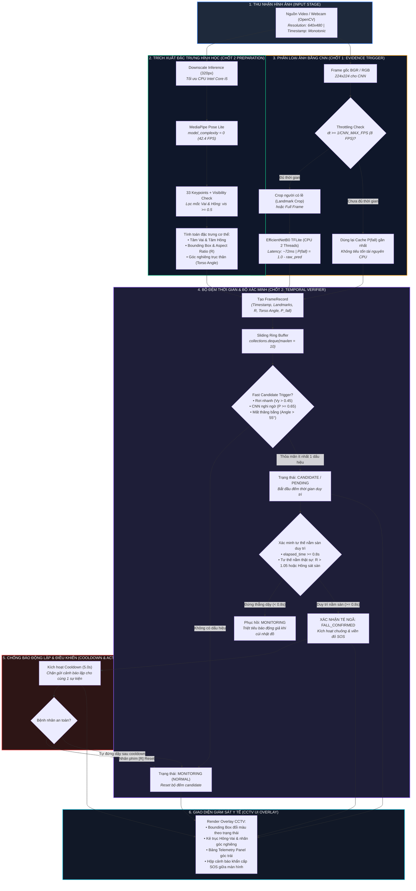
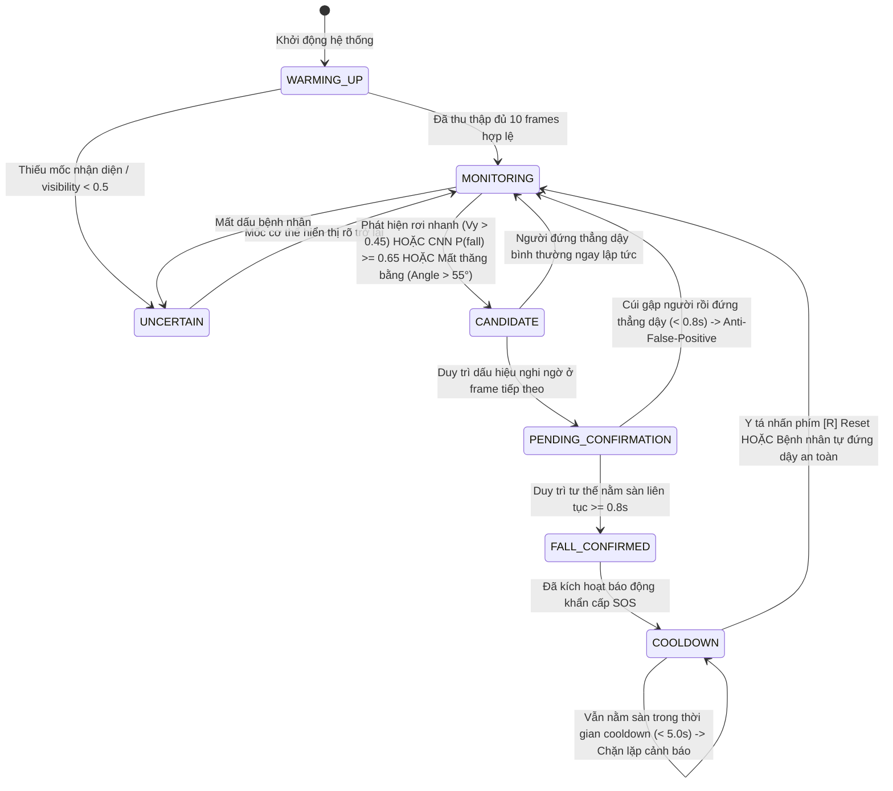

# VINMEC AI MEDICAL HUB — KIẾN TRÚC PIPELINE PHÁT HIỆN TÉ NGÃ (PLAN A UPDATED)

Tài liệu này mô tả chi tiết kiến trúc kỹ thuật của hệ thống **Camera AI giám sát an toàn và phát hiện té ngã bệnh nhân cao tuổi (Two-Stage Real-Time Fall Detection Pipeline)** thông qua các biểu đồ luồng dữ liệu (Flowchart), máy trạng thái (State Diagram) và biểu đồ tuần tự (Sequence Diagram).

---

## 1. Biểu đồ Luồng Xử lý Toàn diện (System Pipeline Architecture)

Biểu đồ dưới đây minh họa luồng đi của dữ liệu từ thiết bị thu nhận hình ảnh qua **Chốt 1 (CNN Classifier)** và **Chốt 2 (MediaPipe Pose + Temporal Verifier)** đến giao diện giám sát bệnh viện:

---

## 2. Biểu đồ Máy Trạng Thái Hữu Hạn (FSM State Transition Diagram)

Vòng đời chuyển đổi trạng thái của bệnh nhân được quản lý chặt chẽ theo Finite State Machine:

---

## 3. Biểu đồ Tuần Tự Xử lý 1 Frame (Frame Execution Sequence)

Quy trình đồng bộ và xử lý song song có điều tiết giữa các thành phần trong 1 chu kỳ frame:

```mermaid
sequenceDiagram
    autonumber
    actor Cam as Camera / Video
    participant Pipe as FallDetectionPipeline
    participant Pose as MediaPipe Pose Lite
    participant Feat as Pose Feature Extractor
    participant CNN as FallImageClassifier (TFLite)
    participant Verif as TemporalFallVerifier (Buffer & FSM)
    participant UI as Hospital CCTV Overlay

    Cam->>Pipe: Đọc frame ảnh BGR (Timestamp t)
    
    rect rgb(20, 30, 48)
        Note over Pipe,Pose: Bước 1: Trích xuất mốc cơ thể (Real-time CPU)
        Pipe->>Pipe: Resize nhẹ frame (320px)
        Pipe->>Pose: Gửi frame RGB 320px
        Pose-->>Pipe: 33 Landmarks + Visibility
        Pipe->>Feat: extract_pose_features(landmarks, t)
        Feat-->>Pipe: FrameRecord (Tâm vai, hông, Box W/H, Torso Angle)
    end

    rect rgb(35, 30, 20)
        Note over Pipe,CNN: Bước 2: Chốt 1 - Phân loại ảnh CNN (Throttled 8 FPS)
        alt Đã trôi qua >= 125ms kể từ lần gọi CNN trước
            Pipe->>CNN: predict_fall_probability(frame, bbox, t)
            CNN->>CNN: Crop người 224x224 & Inference 2 threads (~72ms)
            CNN-->>Pipe: Xác suất P(fall) mới
        else Chưa đủ thời gian throttle (< 125ms)
            Pipe->>CNN: Lấy cached P(fall)
            CNN-->>Pipe: P(fall) đã lưu trong cache
        end
    end

    rect rgb(30, 20, 40)
        Note over Pipe,Verif: Bước 3: Chốt 2 - Xác minh thời gian & FSM
        Pipe->>Verif: update(FrameRecord có kèm P_fall)
        Verif->>Verif: Cập nhật Ring Buffer (10 frames)
        Verif->>Verif: Tính Vy theo dt thực tế & Kiểm tra Persistence
        Verif-->>Pipe: DetectionResult (State, is_fall_confirmed, Reason Codes)
    end

    rect rgb(15, 30, 35)
        Note over Pipe,UI: Bước 4: Hiển thị giao diện CCTV Bệnh viện
        Pipe->>UI: render_hospital_overlay(frame, DetectionResult, FrameRecord)
        UI-->>Pipe: Frame đã vẽ Telemetry, Trục Hông-Vai & SOS
        Pipe-->>Cam: Hiển thị lên màn hình OpenCV (>= 40-48 FPS)
    end
```

---

## 4. Bảng Tra cứu Mã Quyết định (Decision Reason Codes)

Khi hệ thống đưa ra quyết định, trường `reason_codes` ghi nhận chuỗi bằng chứng kỹ thuật để phục vụ việc giải trình và gỡ lỗi (Explainable AI):

| Mã quyết định (`reason_code`) | Ý nghĩa kỹ thuật | Trạng thái kích hoạt |
|---|---|---|
| `BUFFER_WARMING_UP` | Chưa thu thập đủ 10 frames ban đầu trong bộ đệm | `WARMING_UP` |
| `FAST_DOWNWARD_MOTION` | Vận tốc rơi dọc hông $v_y > 0.45\text{ screen/s}$ | `CANDIDATE` |
| `HORIZONTAL_POSTURE` | Tỷ lệ khung bao $R > 1.05$ hoặc vai/hông sát sàn ($y > 0.80$) | `CANDIDATE / PENDING` |
| `CNN_SUSPECTED` | Mô hình CNN TFLite dự đoán xác suất ngã $P(\text{fall}) \ge 0.65$ | `CANDIDATE / PENDING` |
| `CHECKING_POSTURE_PERSISTENCE` | Đang theo dõi người bệnh có duy trì tư thế nằm sau candidate | `PENDING_CONFIRMATION` |
| `POSTURE_PERSISTED_FALL_CONFIRMED` | Tư thế nằm sàn duy trì liên tục $\ge 0.8\text{s}$ $\rightarrow$ Xác nhận ngã | `FALL_CONFIRMED` |
| `COOLDOWN_ACTIVE` | Đang trong thời gian 5.0s ngăn phát cảnh báo lặp cho cùng sự kiện | `COOLDOWN` |
| `RECOVERED_STANDING` | Người bệnh đã tự đứng thẳng dậy ($R < 0.9$ và $\theta < 45^\circ$) | `MONITORING` |
| `LOW_VISIBILITY_OR_NO_POSE` | Mốc vai/hông có `visibility < 0.5` hoặc người khuất khỏi camera | `UNCERTAIN` |

